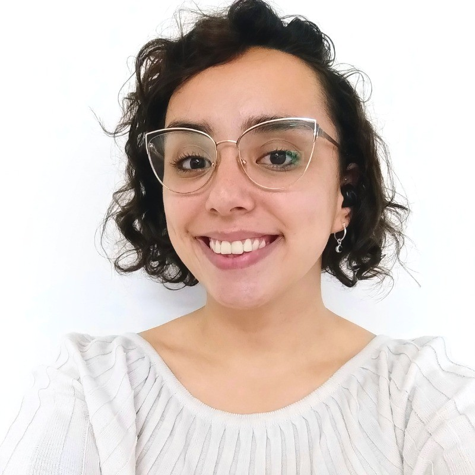
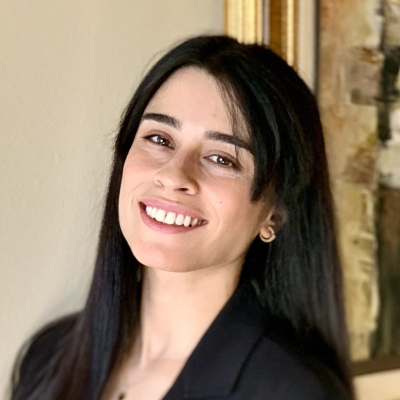
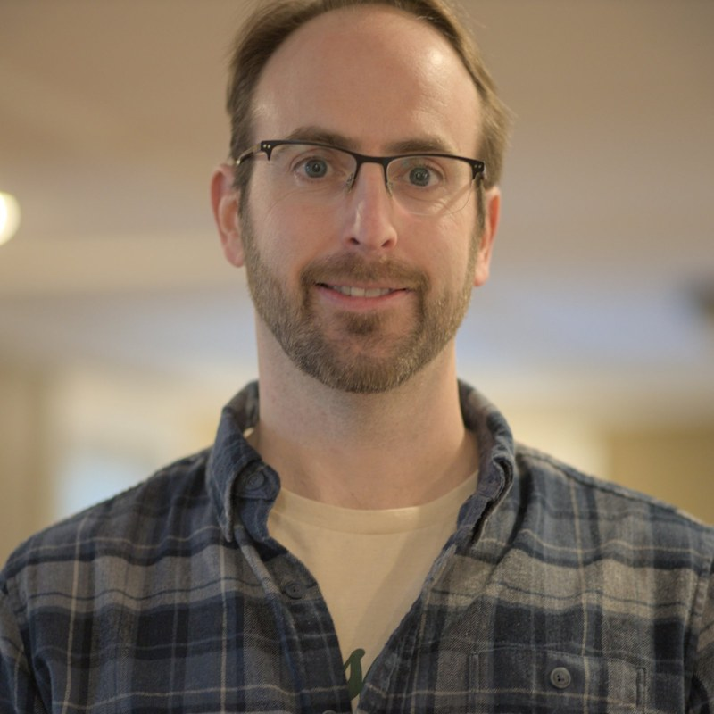

## **Código de conducta** {.30-70-light}

 
 
 

::: incremental
-   🛡️ Todos los espacios de participación R en Buenos Aires, se rigen por el Código de Conducta, ya sean conferencia, charla, taller, reunión, redes sociales y otros medios en línea. Conoce el [Código de conducta de R en Buenos Aires](https://renbaires.github.io/cdc)

-   🌈 Nuestro objetivo es que disfrutes este espacio. Si algo no está bien, contactate con el equipo coordinador o escribí un mail a renbaires@gmail.com
:::

## Comunidad R {.30-70-white}

 

### Nuestra misión

 

Este grupo surge con la misión de **conectar a quienes usan el lenguaje de programación R** en Buenos Aires, independientemente de su grado de conocimiento y el ámbito de aplicación del mismo.

El **objetivo** es *promover el uso R, el aprendizaje continuo y favorecer la creación de proyectos interdisciplinarios*.

## Organizan este encuentro {.content-light}

 

::: columns

::: {.column width="33%"}
{width="50%" style="border-radius: 80%;"}

[**Andrea Gomez Vargas**](https://github.com/SoyAndrea)
:::

::: {.column width="33%"}
{width="50%" style="border-radius: 80%;"}

[**Ariana Bardauil**](https://github.com/ariibard)
:::

::: {.column width="33%"}
{width="50%" style="border-radius: 80%;"}

[**Emanuel Ciardullo**](https://github.com/ECiardullo)

:::
:::

## La charla de hoy {.content-light .smaller}

{width="50%" fig-align="center"}

Vamos a conocer **Posit Connect Cloud**, un entorno moderno en la nube para publicar y mostrar nuestro trabajo.

::: incremental
-   🚀 Funcionalidades clave para compartir y deployar de forma simple
-   🔄 Cómo migrar desde **shinyapps.io** o **Quarto Pub**
-   💻 Demo en vivo: deploy de documentos Quarto y apps Shiny
-   🙋 Preguntas y respuestas abiertas
:::

## Isabella Velásquez {.content-light .smaller}

::::: columns
::: {.column width="60%"}

**Sr. Developer Advocate**

Isabella Velásquez forma parte del equipo de Developer Relations de Posit PBC, donde trabaja en la intersección entre la programación, la comunicación y el análisis de datos para ayudar a las personas a sacar el máximo provecho de las herramientas modernas de ciencia de datos. Es una colaboradora activa de la comunidad R y una firme defensora del código abierto, enfocada en hacer que los flujos de trabajo con datos sean más accesibles y disfrutables para quienes los usan.

:::

::: {.column width="40%"}
{width="65%" style="border-radius: 50%;"}
:::
:::::

## Alex Chisholm {.content-light .smaller}

::::: columns
::: {.column width="60%"}

**Sr. Product Manager**

Alex Chisholm es un profesional de datos que programa con R y Python desde hace más de 15 años. En su rol actual de Product Manager en Posit PBC, Alex trabaja en soluciones de ciencia de datos en la nube, incluyendo Posit Cloud y Posit Connect Cloud. Antes de unirse a Posit en 2022, Alex vivió en Ámsterdam, Países Bajos, donde trabajó para una startup de viajes online y para una empresa de insights educativos. Actualmente vive en San Diego, California, con su esposa y sus dos hijas.

:::

::: {.column width="40%"}
{width="65%" style="border-radius: 50%;"}
:::
:::::

## Próximo encuentro presencial {.content-light}

 

::: {style="text-align: center;"}
[R, IA y comunidad]{style="font-size: 1.6em; font-weight: 600;"}

**Para construir lo que se viene**

 

📅 Martes 1 de diciembre · 18 hs

📝 Inscríbanse en [meetup.com](https://www.meetup.com)
:::

##  {.toc-people-dark}

 
 

::: largest
Gracias!
:::
